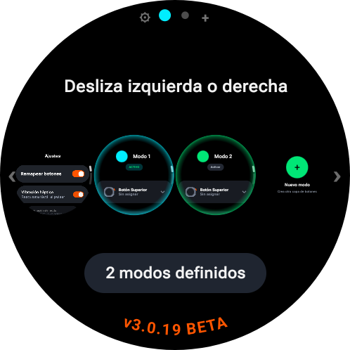
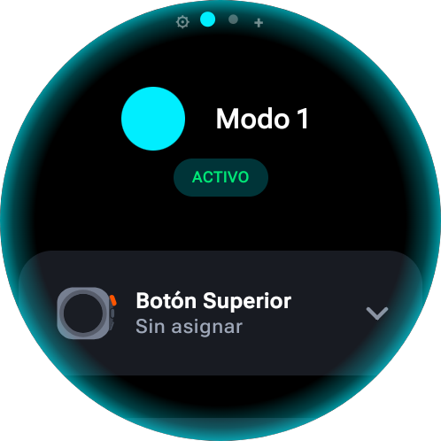
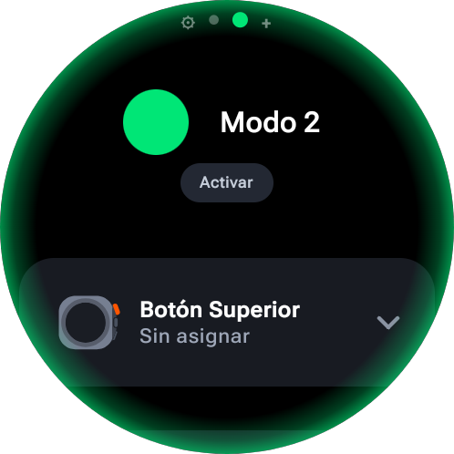
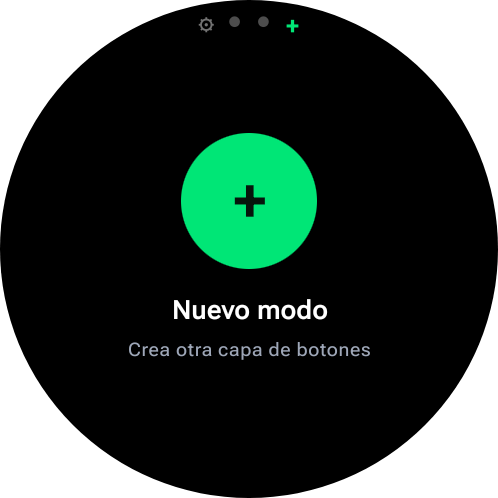
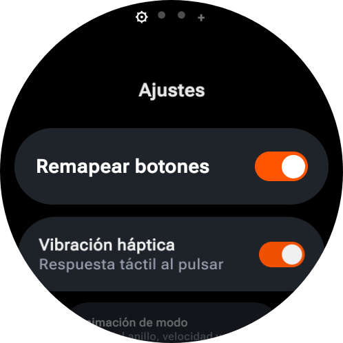
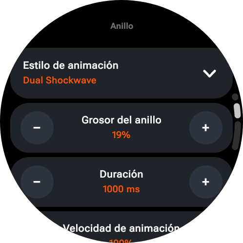
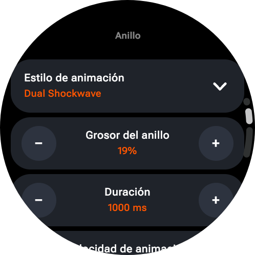
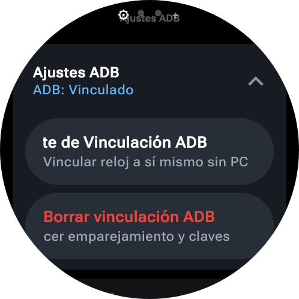
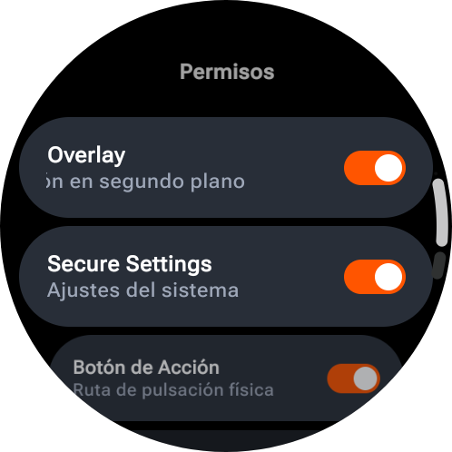

<p align="center">
  
</p>

<h1 align="center">Ultra Remapper</h1>

<p align="center">
  <b>Complete Hardware Button Remapper for Samsung Galaxy Watch Ultra, Ultra 2, Watch 8 Classic, Watch 7, Watch 6 & Wear OS Watches</b><br/>
  <sub>Dynamic Hardware Detection · Quick Button, Bottom Button & Top Button · Phone Companion App & Seamless Bluetooth Bridge · Local In-Watch ADB · Samsung Health Handover · Standalone OTA</sub>
</p>

<p align="center">
  <a href="https://github.com/aaronhrnndz/ultra-remapper/releases/latest">
    
  </a>
  <a href="https://codeberg.org/Aaronhrndz/ultra-remapper/releases">
    
  </a>
  <a href="https://ko-fi.com/Aaronhrndz">
    
  </a>
  <a href="LICENSE">
    
  </a>
  
</p>

<p align="center">
  
  
  
  
  
  <br/>
  
  
  
  
</p>

---

## Highlights

- **Dynamic N-Modes System (v3.0)**: Create unlimited button-mapping profiles, each with its own name, custom RGB color, and button/gesture layout (with automatic migration of existing v2.x settings).
  - **Unlimited Button Combinations (Global Mode-Switch)**: Assign `Switch mode (Next/Previous)` to any button or gesture to cycle through unlimited profiles—giving you virtually unlimited button combinations. That switch gesture is automatically reserved globally across all modes so you never get trapped.
  - **Watch & Mobile Carousels**: Samsung-style circular carousel on the watch (`⚙ • • • +` curved indicator, rotary bezel support, RGB color wheel) and full-card `HorizontalPager` carousel on the Phone Companion.
  - **Futuristic Mode Overlay & N-Pulse Haptics**: 4 customizable perimeter ring animations (*Breathing Plasma*, *Orbital Sweep*, *Dual Shockwave*, *Twin Plasma Arcs*), solid mode-colored pill (position, size, opacity), live preview editor on both watch & phone, and distinct N-pulse vibration per mode.
- **Ultra Remapper Phone Companion App**: Modern, lightweight Material 3 companion app for your phone with zero idle battery drain. Configures your watch modes, buttons, animations, toggles options, and syncs states over native Bluetooth DataLayer.
- **Guided 3-Step Wireless ADB Wizard**:
  - **Automatic Port & PIN Detection**: The watch accessibility service reads the watch IP, 6-digit PIN, and ADB ports straight from Wear OS Developer Settings and streams them to the phone companion via Bluetooth. No manual typing or port scanning needed!
  - **Persistent Pairing State**: No accidental jumps back to pairing fields when reconnecting or if connection drops.
- **Remote Phone Actions (Zero Idle Battery)**: Map wrist buttons to trigger phone features instantly without touching your phone:
  - **Find My Phone**: Rings your phone at maximum volume with vibration (stops on second tap).
  - **Phone Flashlight**: Toggles your phone's rear camera LED.
  - **Phone Camera Shutter**: Opens camera and fires hardware shutter.
  - **Phone Sound / Vibrate**: Toggles phone ringer mode.
- **100% Complete Multilingual Support**: Both Watch and Phone Companion apps fully translated into **English**, **Español**, **Deutsch**, and **Français**.

---

## Capabilities Overview

- **Physical Button Remapping**:
  - **Quick / Action Button** (Galaxy Watch Ultra, Watch 8 Classic): Single press, double press, and hold.
  - **Bottom (Back) Button**: Single tap (with stock Recents/Back preservation), double tap, triple tap, and long press.
  - **Top (Home) Button**: Double press and hold (via Digital Assistant routing).
  - **Wrist Gestures**: Samsung Knock knock (Toc toc) gesture routing.
- **Pure Event-Driven Phone Actions**: Launch phone actions from the watch with 0.0% standby battery consumption using the OS WearableListenerService.
- **In-Watch & In-Phone ADB Pairing Wizards**: Pair locally on your wrist or pair via the phone companion using native TLS 1.3 / SPAKE2. Grant privileges and manage system tweaks without a PC.
- **Samsung Pay / Wallet Freeze**: One-tap toggle to freeze Samsung Pay (`pm disable-user --user 0 com.samsung.android.samsungpay.gear`), eliminating system intercept conflicts for 100% reliable bottom-button long press gestures.
- **Smart Diagnostics**: Warning banners only appear when an active shortcut needs attention, with direct jump-to-fix shortcuts.
- **Samsung Health Foreground Handover**: When Samsung Health is actively recording an exercise, the Action button yields seamlessly to native workout controls (pause/lap).
- **RGBW Tactical Flashlight**: Touch wheel and bezel-based continuous hue tuning + auto Max/Boost hardware cycling for Samsung's native white flashlight.
- **Smart Utilities**: Water lock, speaker water ejection sweep, LTE toggle, GPS parking saver & walking navigation back to car, DND sync, and Home Assistant voice assist.
- **Autonomous OTA Updates**: Background release checks with in-watch and in-companion direct installers.
- **Wear OS Tile & Watchface Complications**: Quick-toggle **Wireless ADB Tile** and **Complications** (`SHORT_TEXT` / `LONG_TEXT` with live IP:port) for instant 1-tap ADB access straight from your watchface.

---

## Download & Installation

> [!IMPORTANT]
> **Migrating from an older version?** The previous GitHub repository is offline, so older versions cannot receive OTA updates automatically. Please download and install the **latest release** manually once—from there onward, automatic OTA updates work seamlessly across **Codeberg** and **GitHub**.

Download the latest prebuilt APKs from the [**GitHub Releases**](https://github.com/aaronhrnndz/ultra-remapper/releases/latest) page (or [**Codeberg Mirror**](https://codeberg.org/Aaronhrndz/ultra-remapper/releases)):
- **`ultra-remapper-watch-vX.X.X.apk`**: App for your Wear OS smartwatch.
- **`ultra-remapper-companion-vX.X.X.apk`**: Companion app for your Android phone.

> [!TIP]
> You can install the **Phone Companion App** first, and it will automatically guide you through pairing, installing, and configuring Ultra Remapper on your watch with 1 click over Wireless ADB!

---

### 📱 Method A: Setup via Phone Companion (Recommended)

1. Install `UltraRemapper-Companion-Mobile-vX.X.X.apk` on your Android phone.
2. Open the Companion app. It connects to your watch immediately via Bluetooth.
3. Open **Settings › Wireless ADB Connection** inside the app.
4. Follow the **3-Step Wizard**:
   - Tap **Open Wireless Debugging on Watch**.
   - Tap **Pair new device** on the watch. The companion automatically receives the IP, port, and 6-digit PIN and pairs.
   - Tap **Install / Update Watch App** to deploy Ultra Remapper directly to your watch!

---

### ⌚ Method B: Standalone Setup on the Watch (No PC or Phone required)

1. Connect the watch to Wi-Fi.
2. In watch **Settings › Developer options › Wireless debugging**, enable it and tap **Pair new device**.
3. Open Ultra Remapper on the watch, go to **Settings › ADB Settings › Local ADB Pairing Wizard**, and enter the 6-digit PIN.
4. Go to **Settings › Permissions** to grant all elevated permissions (Overlay, Secure Settings, Action Route, Notification Listener, Battery Whitelist) and freeze Samsung Pay with 1 tap.

---

### 💻 Method C: Setup via PC Wireless ADB

1. Enable **Settings → Developer options → ADB debugging** and **Wireless debugging** on your watch, then pair and connect:
   ```bash
   adb pair <WATCH_IP>:<PAIRING_PORT>
   adb connect <WATCH_IP>:<CONNECTION_PORT>
   ```
2. Install the watch APK:
   ```bash
   adb install -r UltraRemapper-Watch-*.apk
   ```
3. **All-In-One Megacommand** (grants all elevated permissions in 1 second):
   ```bash
   adb shell "settings put global setting_action_button_press com.aaronhrndz.ultraremapper/com.aaronhrndz.ultraremapper.ActionButtonService && settings put global setting_home_key_long_press googlevoiceassistant/googlevoiceassistant && settings put secure assistant com.aaronhrndz.ultraremapper/.AppVoiceInteractionService && settings put secure voice_interaction_service com.aaronhrndz.ultraremapper/.AppVoiceInteractionService && settings put secure enabled_accessibility_services com.aaronhrndz.ultraremapper/com.aaronhrndz.ultraremapper.BottomButtonService && settings put secure accessibility_enabled 1 && appops set com.aaronhrndz.ultraremapper SYSTEM_ALERT_WINDOW allow && cmd notification allow_listener com.aaronhrndz.ultraremapper/com.aaronhrndz.ultraremapper.MediaControlService && pm grant com.aaronhrndz.ultraremapper android.permission.WRITE_SECURE_SETTINGS && pm grant com.aaronhrndz.ultraremapper android.permission.ACCESS_FINE_LOCATION && cmd deviceidle whitelist +com.aaronhrndz.ultraremapper"
   ```

---

## ⚠️ Beta Channel & Disclaimer

> [!WARNING]
> **Beta Channel (7-Tap Unlock):** You can opt into pre-release/beta builds by tapping the **App Version** 7 times in **Settings** (on either the watch or the phone companion). Beta builds are **work-in-progress, unstable snapshots**—features may break, crash, or stop working unexpectedly. If you prefer a smooth, reliable experience, stay on the **stable channel** (beta disabled).

> [!CAUTION]
> **Disclaimer:** This software is provided **"AS IS"**, without warranty of any kind, under the GPL-3.0 license. The author assumes **no responsibility or liability** for any issues, data loss, battery drain, device behavior, or damages arising from using either stable or beta builds. Use at your own risk.

---

## ☕ Support & Donations

If Ultra Remapper made your Galaxy Watch experience significantly better, consider supporting future development with a coffee:

<p align="center">
  <a href="https://ko-fi.com/Aaronhrndz">
    
  </a>
</p>

---

## Credits & Acknowledgments

This project is an independent evolution of [**bennybar/ultra-remapper**](https://github.com/bennybar/ultra-remapper), originally created by [**@bennybar**](https://github.com/bennybar). Credit to Benny for reverse-engineering Samsung's `setting_action_button_press` service mechanism.

---

## License

Licensed under the **GNU General Public License v3.0 (GPL-3.0)**. See [LICENSE](LICENSE) for full details.
